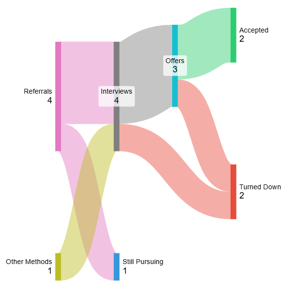
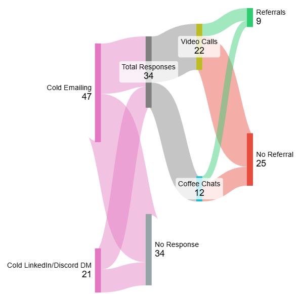

# kalebkim.dev

Static site. No build step, no dependencies. Edit, commit, push — Cloudflare
redeploys on push to `main`.

**You only ever edit `js/content.js`.** Everything else renders itself from it.

---

## Add a project

Open `js/content.js`, find the `projects:` list, paste this inside the
brackets:

```js
{
  name: "Requirements Tracer",
  image: "img/req-tracer.png",
  body: `
What it is and what you built.

A second paragraph if you want one.
`
},
```

Only `name` and `body` are required. Everything else is optional:

| Field    | What it does |
|----------|--------------|
| `image`  | Thumbnail in the left slot of the card. Leave it out and the text takes the full width. |
| `tag`    | Small label top-right of the card — `"Open source"`, `"Hardware"` |
| `title`  | Headline inside the card. Defaults to `name`. |
| `stack`  | One line — `"c++, clang, python"` |
| `result` | A "Result" line under the body |
| `links`  | Buttons — `[["GitHub", "https://..."], ["Demo", "https://..."]]` |
| `blurb`  | One-line summary in the index. Auto-derived from `body` if omitted. |

The index bar on the left, the entry count, and the scrollspy highlight all
build themselves from this list.

### Thumbnails

Drop the file in `img/`. The slot is **16:10** and crops to fill, so size the
image to that ratio or accept the crop. **960 × 600** is plenty — anything
bigger just makes the page slower.

```js
image: "img/req-tracer.png",
```

---

## Add a blog post

Same file, the `posts:` list. **Newest goes first** — the top entry is what
shows in the "Latest post" panel on the home page.

```js
{
  date: "2026-12-01",
  title: "Title of the post",
  body: `
First paragraph.

Second paragraph. Blank lines separate paragraphs — don't use <p> tags.
`
},
```

`date` and `title` are required. The URL slug, the excerpt on the blog list,
the teaser on the home panel and the reading time are all derived for you.
Override any of them with `id`, `excerpt`, `read`.

---

## Images inside a post or project body

Put the image on **its own line** with a blank line above and below:

```

```

If the image has a **white background of its own** (a chart, a screenshot of a
light-mode app), add `{light}` so it sits on a white card instead of looking
like a hole in the page:

```
 {light}
```

Full example:

```js
{
  date: "2026-12-01",
  title: "Some post",
  body: `
Here's what happened over the last month.

 {light}

And here's what I took from it.
`
},
```

Files go in `img/`. Reference them as `img/filename.png` — always relative,
never a leading slash.

---

## Preview before you push

```sh
python3 -m http.server 8000
```

Then open `http://localhost:8000`. Opening `index.html` as a file won't work
properly — it needs to be served.

---

## Deploy

Commit and push to `main`. Cloudflare Workers builds from `wrangler.jsonc`,
which serves the whole repo as static assets minus whatever is listed in
`.assetsignore`.

If a change doesn't show up, **hard-refresh** (`Ctrl+Shift+R` / `Cmd+Shift+R`)
before assuming the deploy failed. Edge and browser caching will happily serve
you the old page.

---

## File map

```
index.html      home — hero, profile, latest post, projects, contact
blog.html       blog list and individual post pages (hash-routed)
css/site.css    all styling
js/content.js   ← the only file you edit
js/render.js    turns content.js into the page
js/hero.js      canvas renderer for the ASCII art
js/cloud-sea.js the "cloud sea" piece by @bas3line (MIT), ported from ascii.rest
img/            pictures and the ridge backdrop
```
